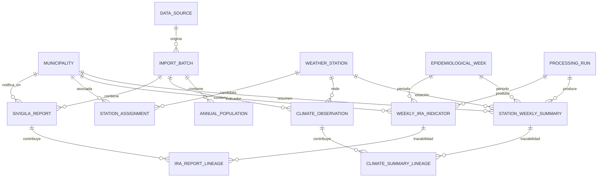

# Modelo de datos propuesto — RESPIRA

**Estado:** diseño lógico/físico. Implementado parcialmente en la Fase 2.2 (siete tablas fuente, migración `0003`; ver [README](README.md#implementación-fase-22)). Las entidades derivadas, `epidemiological_week`, `station_assignment` y `processing_run` siguen siendo propuesta.

## Principios

1. Conservar cada archivo y fila fuente como evidencia inmutable, asociada a una versión, hash cuando esté disponible y ubicación original (hoja/fila).
2. Separar observaciones originales de indicadores derivados; toda transformación registra versión de reglas, ejecución e insumos.
3. Usar códigos DIVIPOLA como texto de cinco caracteres, no como identificadores numéricos con pérdida de ceros.
4. Diferenciar cero observado, ausencia de fila, valor no interpretable y dato pendiente de resolución.
5. No confundir reportes colectivos, prestadores o filas con pacientes únicos, residencia ni incidencia.
6. Ningún identificador personal forma parte del diseño del piloto.

## Diagrama lógico

## Entidades y claves

| Entidad | Identidad propuesta | Propósito y restricciones |
|---|---|---|
| `data_source` | `source_id` | Fuente institucional, nombre, URL/procedencia, sistema, versión documental conocida. No declara oficialidad sin evidencia. |
| `import_batch` | `batch_id`; único `(source_id, file_sha256, source_version)` cuando el hash exista | Una recepción concreta: nombre/URI local, formato, tamaño, hash opcional, hoja(s), fechas, estado de completitud y fingerprint de esquema. No reemplaza el archivo original. |
| `municipality` | `municipality_id`; único `divipola_code` | DIVIPOLA como `CHAR(5)`, nombre/variante, departamento. La asociación fuente-nombre se valida contra código, no posición ni solo ortografía. |
| `epidemiological_week` | `(epi_year, epi_week)` | Fechas de inicio/fin según calendario INS específico del año. Admite 1–53 solo cuando el calendario correspondiente lo sustenta. `FEC_NOT` permanece como otro campo/atributo fuente. |
| `weather_station` | código IDEAM como texto | Código, nombre de catálogo, coordenadas/altitud y estado con procedencia. |
| `station_assignment` | `assignment_id` | Relación candidata estación–municipio, vigencia y estado de representatividad. Una estación no se declara representativa por coincidir el municipio en un catálogo. |
| `sivigila_report` | `report_id`; único `(batch_id, sheet_name, source_row_number)` | Fila colectiva de evento 995, código municipal notificador, año/semana, prestador/sede institucionales, `NUM_CON` y campos IRACEXT disponibles. Mantiene filas repetidas; no añade unicidad proveedor-semana. |
| `climate_observation` | `observation_id`; único `(batch_id, sheet_name, source_row_number)` | Observación fuente estación-fecha-variable-valor, unidad original, texto original de fecha/valor y estado de calidad/parseo. No impone unicidad fecha-estación-variable entre fuentes/versiones. |
| `annual_population` | `(batch_id, municipality_id, reference_year, population_area, age_min, age_max, sex)` | Proyección anual DANE según versión/libro; área `Total`, edad 0–4 y sexo `Total` cuando corresponda. No replica el dato anual 52 veces por semana. |
| `processing_run` | `run_id` | Código/versión de reglas, parámetros, hash de entradas, fecha, estado y responsable del procesamiento. No contiene credenciales. |
| `weekly_ira_indicator` | `indicator_id`; candidato único por `(run_id, municipality_id, epi_year, epi_week, definition_code)` | Indicador derivado con valor nullable, unidad y estado: por ejemplo `reported_value`, `no_source_row`, `unresolved_repeat`, `not_processed`. El cero sólo se almacena como cero si fue reportado/calculado según regla explícita. |
| `ira_report_lineage` | clave compuesta indicador/fila | N:M entre indicador y reportes; registra rol de inclusión/exclusión y motivo. Permite auditar suma o resolución futura. |
| `station_weekly_summary` | `summary_id` ligado a ejecución, estación, variable y semana | Agregado derivado, cobertura válida, cobertura esperada, regla, unidad y estado; valor nullable. Reglas del piloto (p. ej., mínimo 6 de 7 días) son explícitas y versionadas. |
| `climate_summary_lineage` | clave compuesta resumen/observación | Observaciones diarias incluidas y excluidas con motivo, para reconstruir agregados. |
| `data_quality_issue` | `issue_id` | Hallazgos tipificados, severidad, fila/entidad afectada, estado y evidencia acotada no personal. |

## Cardinalidades y reglas que evitan pérdida de evidencia

- Una recepción puede aportar muchas filas; una fila identificada por lote, hoja y número de fila mantiene procedencia incluso si valores de negocio se repiten.
- La fila SIVIGILA es un reporte colectivo. Dos filas de la misma UPGD y semana con distinto `NUM_CON` se conservan y se vinculan al mismo grupo de revisión. Hasta que exista regla oficial de corrección, su estado derivado es no resuelto; no se deduplican ni suman silenciosamente.
- El valor agregado semanal puede no existir aunque el calendario contenga la semana. La ausencia de notificación no se convierte en cero.
- Una observación climática diaria conserva flags de calidad desconocidos como desconocidos. Agregados que no alcanzan cobertura quedan nulos con estado/cobertura explicativos.
- DANE es anual y no se replica para aparentar observaciones semanales independientes. Un eventual cálculo de tasa requerirá decisión epidemiológica separada, denominador apropiado y autorización metodológica.
- Datos sintéticos de la aplicación actual deben conservar una etiqueta de origen sintético distinta de los datos oficiales.

## Posible correspondencia con la aplicación actual

El modelo SQLAlchemy vigente (`Municipality`, `IraCase`) es suficiente para la demo local, pero no expresa DIVIPOLA como clave natural, provenance, batches, calidad/missingness, reportes colectivos repetidos, calendario anual ni las fuentes crudas. `IraCase` exige variables climáticas numéricas y los esquemas API/TypeScript no representan nulos/estado. Por ello esta propuesta no es migración compatible lista para activar: requiere una decisión de producto y cambios futuros explícitos, que no forman parte de Fase 5.
